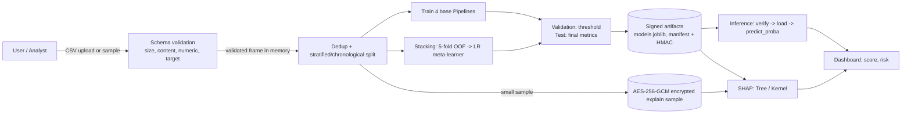
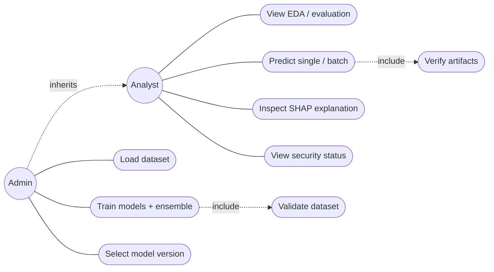
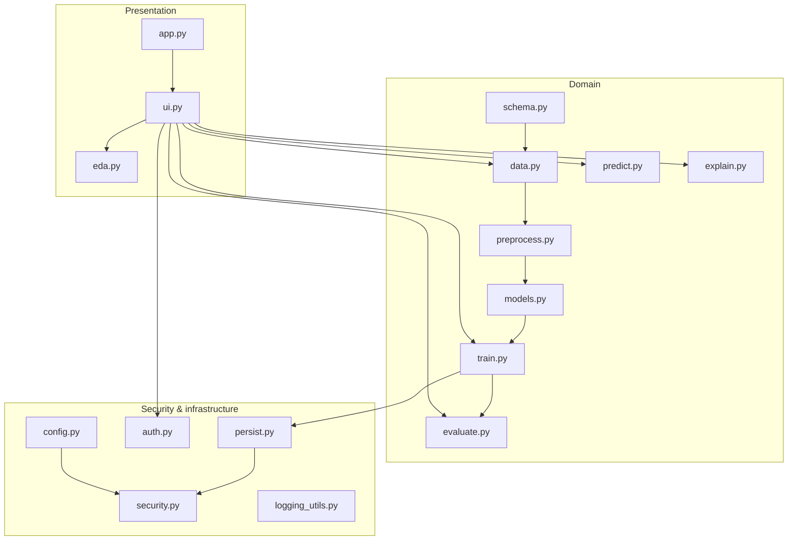

# System Architecture

## Layers
Streamlit UI (`ui.py`) -> auth/RBAC (`auth.py`) -> services (`data`, `train`, `predict`, `explain`) -> persistence with integrity checks (`persist.py`) -> encrypted/signed files on local disk.

## Data-flow diagram

## UML use-case diagram

## UML component diagram

## Training and inference workflow
1. Validate (size, UTF-8, header, names, numeric, finite, binary target, class minimums, sensitive columns excluded).
2. Remove exact duplicate rows, then split (stratified 60/20/20, or chronological when `Time` exists).
3. Fit four `Pipeline(preprocessor -> classifier)` objects on the **training split only**; fit `StackingClassifier` on the same training split.
4. Predict probabilities on validation (choose F1-optimal threshold per model) and test (report metrics).
5. Save artifacts atomically, sign manifest. Inference loads only after signature + SHA-256 verification and uses the stored pipelines (identical preprocessing).

## Stacking architecture
Level-0: Logistic Regression (scaled), Random Forest, XGBoost, LightGBM - each a Pipeline with median imputation.
Level-1: `LogisticRegression` on the 4 out-of-fold fraud probabilities (`StackingClassifier(cv=StratifiedKFold(5), stack_method="predict_proba", passthrough=False)`).
After the meta-learner is fitted, base learners are refit on the whole training split for inference (scikit-learn behaviour).
